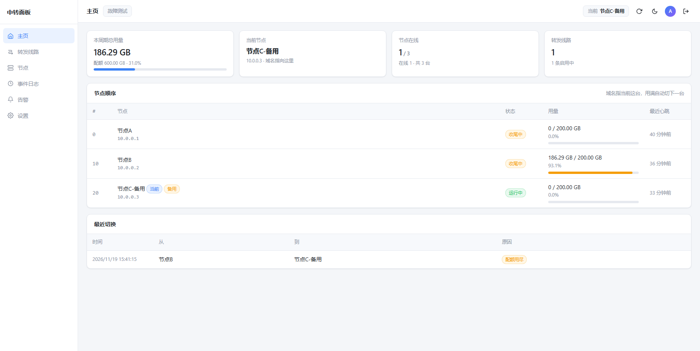

# relay-panel · 中转面板

多台 VPS 拼流量池，一个面板统一管：分组、配额、一键接入、用满自动切 DNS。

自己用的小型转发面板。单二进制，零外部依赖（不需要 MySQL / Redis / nginx）。



## 它解决什么问题

手里一堆 200G 流量的小鸡，想当成一条线路用：

```
域名 relay.example.com
   │
   ├─▶ 节点A（200G）  ─┐
   ├─▶ 节点B（200G）  ─┼─ 同一套转发规则
   └─▶ 节点C（备用）  ─┘
```

- 所有节点预置同一套转发规则，域名指哪台哪台干活
- 哪台用满了，自动改 DNS 切到下一台
- 哪台挂了（心跳 75 秒没动静），**立刻切走**，不等用量
- 主用全用完或全失联，切到备用节点兜底
- 全部不可用，只告警，不会乱切到死节点

## 特性

| 能力 | 说明 |
|---|---|
| 分组管理 | 一组节点 + 一套规则 + 一条域名 |
| 两级配额 | 节点各自 200G，按网卡实际用量算 |
| 一键接入 | 面板生成命令，节点上 curl 一下就跑起来 |
| 规则同步 | 规则全量下发，版本号对不上才推 |
| 自动切流 | 用量到阈值 / 节点失联 两种触发 |
| 备用节点 | 主用全挂时兜底 |
| 延迟探测 | 面板到节点的 TCP 握手 RTT，两分钟一轮 |
| Cloudflare | 自动解析 Zone、自动建记录、切 A 记录 |
| 批量导入导出 | JSONL，兼容 Nyanpass 格式 |
| 手机端 | 底部导航、表格横滚 |
| 深色模式 | 记住选择 |

**不支持**：UDP 转发、多用户、套餐计费。

## 流量口径

面板读节点上的 `/proc/net/dev`——**商家后台用的同一个计数器**。

不会出现「面板说还剩 50G，商家已经把机器停了」这种事。计费口径可选双向 / 只算出向 / 只算入向，按商家后台对一遍就知道该选哪个。

## 编译

需要 Go 1.23+。零第三方依赖，不用 `go mod download`。

```bash
make panel    # 当前平台面板
make linux    # 三架构节点端（amd64 / arm64 / arm）
make node     # 当前平台节点端（本地调试用）
```

或手动：

```bash
go build -o bin/panel ./cmd/panel

GOOS=linux GOARCH=amd64 go build -trimpath -ldflags="-s -w" -o bin/node-linux-amd64 ./cmd/node
GOOS=linux GOARCH=arm64 go build -trimpath -ldflags="-s -w" -o bin/node-linux-arm64 ./cmd/node
GOOS=linux GOARCH=arm   go build -trimpath -ldflags="-s -w" -o bin/node-linux-arm   ./cmd/node
```

## 部署

详细步骤见 [install/DEPLOY.md](install/DEPLOY.md)。

快速开始：

```bash
# 面板机
./bin/panel -config /opt/relay-panel/config.json

# 或者用安装脚本
bash install/install-panel.sh --port 8080 --url http://你的IP:8080
```

节点机：

```bash
curl -fsSL http://你的面板/i.sh | bash -s -- --panel=http://你的面板 --token=xxxxx
```

## 目录

```
cmd/panel/          面板入口
cmd/node/           节点入口
internal/panel/     存储、API、调度、DNS、Web UI
internal/node/      Agent、TCP 转发器、网卡采样
install/            systemd 单元 + 安装脚本
docs/               界面截图
```

## 数据

整个状态就是一个 JSON 文件：

```
/opt/relay-panel/data.json
```

备份直接 `cp`。配置 `config.json` 含 Cloudflare Token，别外传。

## 已知限制

| 限制 | 说明 |
|---|---|
| 只支持 TCP | UDP 还没做 |
| 串行切流 | 同一时刻只有一台节点在出力 |
| 切换有窗口 | TTL 60 秒时约 1–2 分钟，靠 5% 余量兜住 |
| 单管理员 | 没有多用户和计费 |
